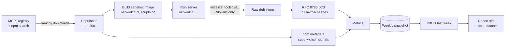

<div align="center">

# 🔭 ToolCensus

### A weekly, open health report for the MCP server ecosystem

**What do the MCP servers your AI uses actually tell it, and how often does that change?**

[](LICENSE)
[](LICENSE-DATA)
[](pyproject.toml)
[](METHODOLOGY.md)
[](ETHICS.md)

[What it measures](#-what-it-measures) ·
[Try it in 60 seconds](#-try-it-in-60-seconds) ·
[Use it in CI](#-use-it-as-a-ci-gate) ·
[The dataset](#-the-open-dataset) ·
[Safety](#%EF%B8%8F-safe-by-construction) ·
[Methodology](METHODOLOGY.md)

</div>

---

## 🧭 The problem in one picture

Claude Desktop, Cursor, VS Code and agent frameworks connect to third-party **MCP servers**. Each
server hands the AI a list of **tools**: a name, a description and an input schema. **The AI
trusts that text.**

```text
 ┌──────────────┐   "here are my tools"    ┌──────────────┐
 │  MCP server  │ ───────────────────────▶ │   Your AI    │  reads names, descriptions and schemas,
 │   v1.2.0     │                          │  assistant   │  then decides what to call
 └──────────────┘                          └──────────────┘
        │  npm publish v1.3.0  (same name, different tool text?)
        ▼
 ┌──────────────┐
 │  MCP server  │   Did a description change? Did a schema quietly start accepting more?
 │   v1.3.0     │   Was it published with provenance? Does it run install scripts?
 └──────────────┘   Nobody is tracking this across the ecosystem... until now.
```

There are many good tools that pin or scan **one** server. What has been missing is
**neutral, longitudinal, ecosystem-wide measurement** that maintainers, users and standards
bodies can cite. ToolCensus provides it.

> **ToolCensus is a census, not a scanner.** It records facts (*"tool description changed between
> v1.2.0 and v1.3.0"*, *"no provenance attestation"*). It never labels a project safe or unsafe,
> and it never runs a server's tools.

---

## 📊 What it measures

Every week, for the **top 200** public MCP servers on npm (picked from the official MCP Registry
and npm search, ranked by downloads):

| | Signal family | Example questions it answers |
|---|---|---|
| 📦 | **Supply chain** | What share of servers publish with npm provenance? How many run `postinstall` scripts? Is the source repo linked? |
| 🔀 | **Tool-surface drift** | How often do tool definitions change? Did the schema get *wider* (accepts more) or *narrower*? Did the tools change **without** a version bump? |
| 📐 | **Schema strictness** | Do tools declare `required`? Do they set `additionalProperties: false`? How many string inputs are constrained? |
| 🏷️ | **Annotation adoption** | What share of tools declare `readOnlyHint` / `destructiveHint`? Which servers annotate *every* tool? |
| 🔍 | **Description hygiene** | How long are descriptions? How many contain invisible Unicode or HTML-like tags? (counts only, never the text) |
| 🔐 | **Auth metadata** *(phase 2)* | Do remote servers publish OAuth protected-resource metadata? |

Each metric has an exact definition, data source and limitations in
**[METHODOLOGY.md](METHODOLOGY.md)**, and every record is stamped with the methodology version
that produced it.

---

## ⚡ Try it in 60 seconds

You need **Docker** (every third-party server runs in a locked-down container) and
**[uv](https://docs.astral.sh/uv/)**.

```bash
git clone https://github.com/vidhan843426/toolcensus && cd toolcensus
uv sync
uv run toolcensus check @modelcontextprotocol/server-filesystem
```

This is real output from the run that validated this release:

```text
@modelcontextprotocol/server-filesystem@2.0.0
  status            ok
  server            secure-filesystem-server 2.0.0
  protocol          2025-11-25

  supply chain
    provenance            yes
    install scripts       none
    direct dependencies   5
    maintainers           6
    releases (90 days)    3
    repository linked     yes
    MCP Registry listed   no

  tools (14)  surface sha256:69b3e7744b7f5a85aa33e8f80c32d7571eb4460eb6928fa58761bcbe4801318e
    create_directory                 c736eae545b2  ann=readOnly=no,destructive=no,idempotent=yes,openWorld=no
    read_file                        2072073670c6  ann=readOnly=yes,openWorld=no
    ...

  annotated tools 100%  ·  side-effect verbs without hint 0

  improvement hints
    - Consider listing the server in the official MCP Registry.
    - Consider `additionalProperties: false` on the input schema of 13 tool(s) so unexpected arguments are rejected.
```

Add `--json` to get the full machine-readable record.

> 💡 Once ToolCensus is published to PyPI, this becomes a one-liner: `uvx toolcensus check <package>`.

### 🛠️ Building your own MCP server?

Check it **before** you publish, straight from your working copy:

```bash
uv run toolcensus check-local "node dist/index.js"
```

It uses the same metadata-only client. It is *not* sandboxed, so only use it on your own code.

---

## 🚦 Use it as a CI gate

Save a record of a server's tool surface after you have reviewed it. Then fail the build if the
server's tools change without you noticing:

```bash
# once, after reviewing the server:
toolcensus check some-mcp-server@1.4.0 --json > .mcp/some-mcp-server.json

# in CI:
toolcensus check some-mcp-server --json > /tmp/current.json
toolcensus diff .mcp/some-mcp-server.json /tmp/current.json --fail-on-change
```

Example of what a failing gate prints:

```text
some-mcp-server 1.4.0 -> 1.5.0  search: input_schema_changed [schema_widened]
  - property 'limit' added (optional); property 'mode': enum constraint removed; additionalProperties loosened
```

| Exit code | Meaning |
|---|---|
| `0` | No tool-surface changes |
| `1` | At least one change (with `--fail-on-change`) |
| `2` | Input could not be read |

Use `--format sarif` to see changes as **GitHub code-scanning alerts**. A ready-made composite
action is in [`action.yml`](action.yml).

---

## 🗃️ The open dataset

All results are published as plain files under **CC BY 4.0**, so you can analyse them with
whatever tools you like.

```text
data/
├── snapshots/2026-43/
│   ├── population.json     # which servers, the selection rule, and every exclusion with its reason
│   ├── servers.jsonl       # one record per server: full tool definitions, hashes, every metric
│   └── diffs.jsonl         # classified changes vs the previous week
├── backfill/               # history rebuilt from past npm versions (clearly marked)
└── dataset/                # flat CSV / Parquet: servers, tools, changes, weekly_aggregates
schemas/                    # JSON Schemas for every record type (validated in CI)
```

```python
import pandas as pd

tools = pd.read_csv("data/dataset/tools.csv")
latest = tools[tools.week == tools.week.max()]
print(f"{latest.ann_readOnlyHint.mean():.0%} of tools declare readOnlyHint")
```

```bash
uv run toolcensus dataset --sqlite census.sqlite   # then query it with any SQL tool
```

**Every number in the report can be rebuilt from committed data with one command:**
`uv run toolcensus verify-data && uv run toolcensus dataset && uv run toolcensus report`.

---

## 🛡️ Safe by construction

Running public packages means running untrusted code, so the ground rules are **enforced in code
and proven by tests**, not just written down:

| Guarantee | How |
|---|---|
| 🚫 **Never calls a tool** | The MCP client sends messages through one choke point with an allowlist of 6 metadata methods. It has no `call_tool` code at all. Tests try *every* method defined in the official SDK and check the wire to confirm nothing else is sent. |
| 📦 **Sandboxed** | Install (with network) and run (with `--network none`) are separate steps. At run time: read-only root filesystem, non-root user, `--cap-drop ALL`, `no-new-privileges`, CPU/memory/PID limits, 60 s hard timeout. Integration tests prove outbound connections fail. |
| 🧹 **Leaves nothing behind** | Each server is installed into a throwaway Docker volume that is deleted right after it is measured, so scans don't fill your disk. `toolcensus clean` removes anything an interrupted run left (`--all` also drops the base image, `--cache` the HTTP cache). |
| 🔑 **No secrets, ever** | Host environment variables are never forwarded. Required config gets an obvious placeholder (`toolcensus-placeholder-not-a-real-secret`). Anything else is rejected in code. |
| 🤝 **Responsible disclosure** | Anything that might need private handling is written only to a git-ignored `private/` directory. A test checks that none of it leaks into the site or the dataset. |
| 🌐 **Polite to upstream** | Official APIs only, an identifying User-Agent, caching with conditional requests, rate limiting, `Retry-After`, exponential backoff. |
| 🔒 **Hardened CI** | The weekly scan job has a read-only token and no secrets. A separate job validates the data and commits it, without ever running package code. Every action is pinned by commit SHA. |

Read the full ground rules in **[ETHICS.md](ETHICS.md)**.

---

## ⚙️ How it works



- **Hashing you can rely on:** each tool definition is canonicalized with
  [RFC 8785](https://www.rfc-editor.org/rfc/rfc8785) (tested against the RFC's own vectors) and
  hashed. Key order and whitespace never change a hash; any change to the content does. Separate
  component hashes (description, input schema, output schema, annotations) show *what* changed.
- **History from day one:** `toolcensus backfill` rebuilds past versions from npm, so trend
  charts don't have to wait months for data. Backfilled data is always shown separately from live
  observations.
- **Honest backtesting:** `toolcensus backtest` replays publicly disclosed incidents and reports
  **hits and misses with equal prominence**, including why a miss was missed (*"the change was in
  code; tool definitions were unchanged"*).

---

## 🧰 CLI reference

| Command | What it does |
|---|---|
| `toolcensus check <pkg>[@ver] [--json]` | Measure one npm server in the sandbox |
| `toolcensus check-local "<cmd>"` | Measure your own server under development |
| `toolcensus diff A B [--fail-on-change] [--format text\|json\|sarif]` | Compare snapshots or records (CI gate) |
| `toolcensus discover [--top N] [--no-registry]` | Select the population for this week (`--no-registry` is a fast, npm-only mode for experiments) |
| `toolcensus scan [--week YYYY-WW]` | Introspect the whole population and write a snapshot plus diffs |
| `toolcensus backfill --since YYYY-MM-DD` | Rebuild history from past npm versions (resumable) |
| `toolcensus backtest [--from-data]` | Hit/miss scorecard against public incidents → `reports/backtest.md` |
| `toolcensus report [--week YYYY-WW]` | Generate the static site (MkDocs) from committed data |
| `toolcensus dataset [--sqlite F]` | Export flat CSV / Parquet / SQLite tables |
| `toolcensus verify-data` | Validate every data file against the JSON Schemas |
| `toolcensus clean [--all] [--cache]` | Delete everything scans downloaded (sandbox volumes, containers, old images) |
| `toolcensus schemas [--check]` | Regenerate (or check) the published JSON Schemas |

---

## 🗺️ Project status

| Milestone | Status |
|---|---|
| Scaffold, tooling, CI, docs | ✅ |
| Discovery (MCP Registry + npm + downloads, caching, rate limits) | ✅ checked against the live APIs |
| Sandbox runner + allowlisted client + `check` | ✅ checked on real servers (filesystem, memory, context7, playwright) |
| Hashing + supply-chain / schema / annotation / description metrics | ✅ |
| Snapshot storage + diff engine (text / json / sarif) | ✅ |
| Report / site generation | ✅ |
| Weekly automation (separate scan and publish jobs) | ✅ workflow written; first scheduled run pending |
| First real scan (≥ 100 servers) + backfill + first write-up | ⏳ next |
| Incident backtest scorecard | ⏳ incident set ready; runs after backfill |
| PyPI servers, remote auth metadata, reusable Action | 🧪 groundwork in place (phase 2) |

**Quality bar:** `ruff`, `mypy --strict`, 137 unit tests at about 90 % coverage, plus 3 Docker
integration tests for network isolation, read-only rootfs and timeout kill.

---

## ⚠️ Limitations (we would rather you hear them from us)

- Servers that need **real credentials** may not show their tools without them. They are reported
  as `requires_configuration`, so they are under-measured, not hidden.
- Tool definitions can depend on configuration. We measure the **default behaviour in an empty,
  offline sandbox**.
- Weekly sampling misses changes that happen **within a week** (especially on hosted servers).
- The side-effect-verb check is a **heuristic** with false positives and negatives, so it is only
  ever reported in aggregate.
- The population is **popularity-biased by design**: it describes what most people install.

---

## 🤝 Contributing

Corrections to exclusions, launch overrides for servers that need special flags, new public
incidents for the backtest, better metrics: all welcome. Start with
**[CONTRIBUTING.md](CONTRIBUTING.md)**. If you found a problem with ToolCensus itself, please
follow **[SECURITY.md](SECURITY.md)** and report it privately.

```bash
uv sync && uv run pre-commit install
uv run pytest --cov            # unit tests
uv run pytest -m sandbox       # Docker integration tests
```

## 📜 License and citation

- **Code:** [Apache-2.0](LICENSE)
- **Data** (`data/`, `reports/`, the generated site): [CC BY 4.0](LICENSE-DATA)

> ToolCensus (methodology v1.0.0), week YYYY-WW. https://github.com/vidhan843426/toolcensus, CC BY 4.0.

<div align="center">
<sub>Built so the MCP ecosystem can see itself clearly. Measure, don't accuse.</sub>
</div>
