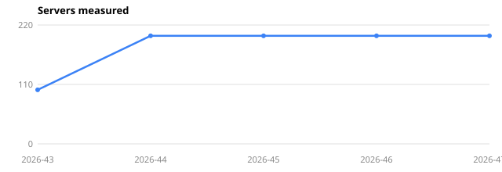
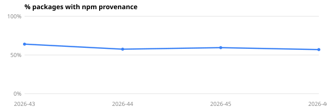
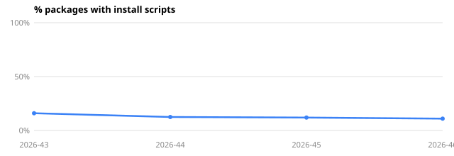
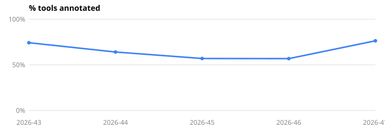
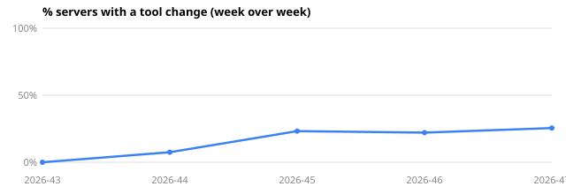

# ToolCensus — MCP ecosystem health report

*Week 2026-46 · methodology v1.0.0 · 200 servers measured*

ToolCensus measures the **published metadata** of popular public MCP servers every week:
supply-chain signals, how precisely tools are described, annotation adoption and how tool
definitions change over time. These are neutral measurements, not security verdicts.

## Headline numbers

| Metric | This week |
|---|---|
| Servers measured | 200 |
| Reached status `ok` | 47.5% |
| Tools measured | 3068 |
| Packages with npm provenance | 57.0% |
| Packages with install scripts | 11.0% |
| Tools declaring any annotation | 56.8% |
| Servers with all tools annotated | 56.8% |
| Tools with `additionalProperties: false` | 26.1% |
| Tools with non-printing code points | 0.0% |
| Servers with a tool change vs previous week | 22.1% |

## Trends

See [Ecosystem trends](trends.md) for every metric, [Servers](servers/index.md) for per-server
pages, and [Download](download.md) for the open dataset.
