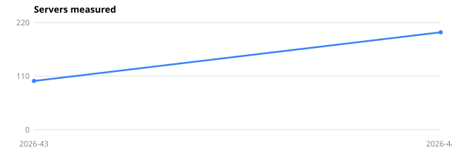
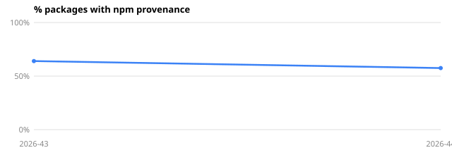
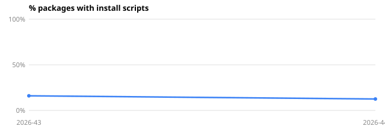
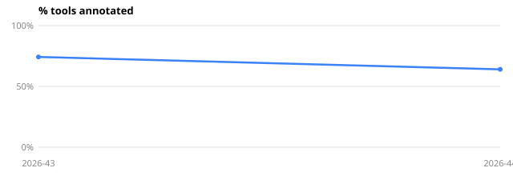
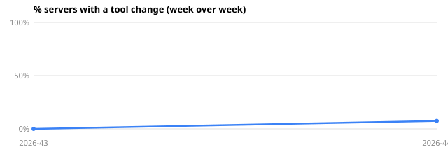

# Ecosystem trends

Live weekly observations.

## All weekly aggregates

| Week | servers_measured | servers_ok | pct_ok_or_classified | pct_ok | tools_measured | median_tools_per_server | pct_provenance | pct_install_scripts | pct_repo_linked | pct_registry_listed | median_direct_dependencies | pct_tools_annotated | pct_servers_all_annotated | pct_tools_side_effect_unannotated | pct_tools_declares_required | pct_tools_additional_properties_false | pct_tools_output_schema | pct_tools_invisible_chars | pct_tools_markup | median_description_length | pct_servers_changed | pct_tools_readOnlyHint | pct_tools_destructiveHint | pct_tools_idempotentHint | pct_tools_openWorldHint | status_ok | status_timeout | status_crashed | status_requires_configuration | status_install_failed | status_not_mcp | 
|---|---|---|---|---|---|---|---|---|---|---|---|---|---|---|---|---|---|---|---|---|---|---|---|---|---|---|---|---|---|---|---|
| 2026-43 | 100 | 47 | 100 | 47 | 1084 | 9 | 64 | 16 | 93 | 36 | 7.5 | 74.2 | 63.8 | 5.3 | 79.6 | 47.8 | 31.8 | 0 | 5.4 | 286.5 | 0 | 71.9 | 63 | 32.1 | 66.9 | 47 | 0 | 20 | 20 | 2 | 11 | 
| 2026-44 | 200 | 93 | 100 | 46.5 | 3388 | 13 | 57.5 | 12.5 | 91 | 33 | 6.5 | 64 | 55.9 | 12 | 72.4 | 38.1 | 20.3 | 0 | 4.5 | 262 | 7.5 | 59.9 | 53.3 | 39.3 | 55.7 | 93 | 1 | 35 | 43 | 2 | 26 | 

